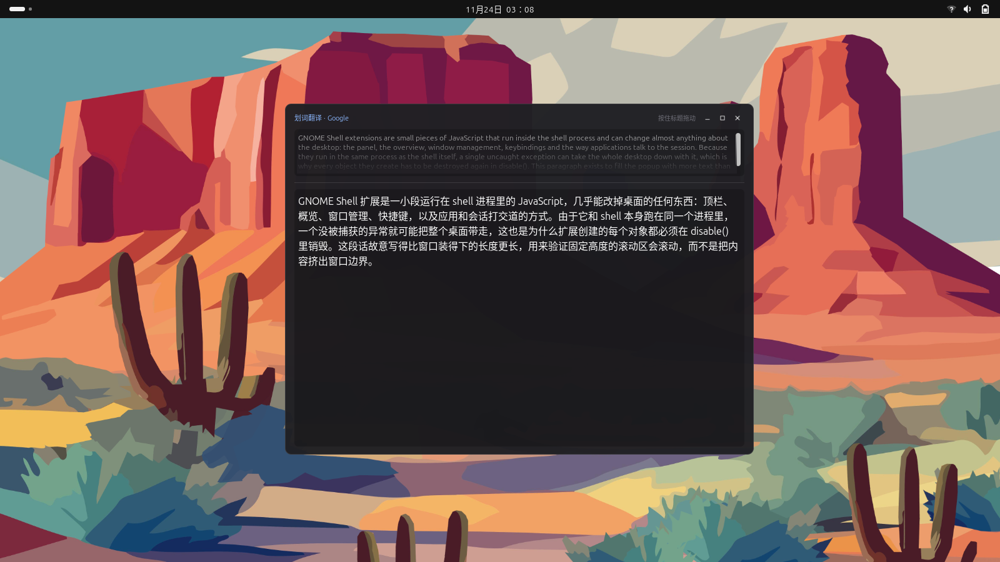
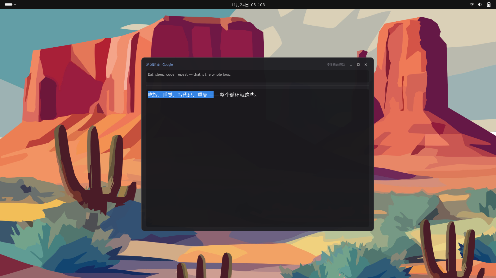
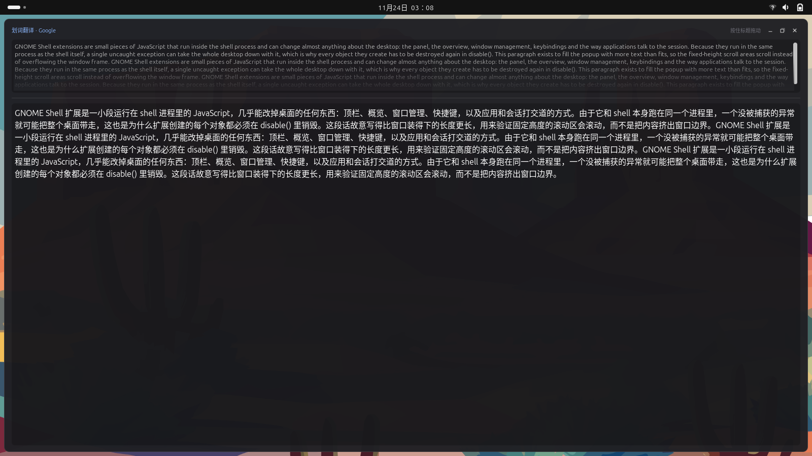

# word-translator 划词翻译

Electron + Node.js 划词翻译工具，多引擎 + 自动降级 + 免 key 开箱即用。

## 引擎

| 引擎 | key | 说明 |
|---|---|---|
| google-free（默认） | 不需要 | Google 网页版接口 `client=gtx`，需能访问 Google |
| transmart | 不需要 | 腾讯交互翻译，国内直连，作为降级备选 |
| google-official | 需要用户自己的 | Google Cloud Translation API v2，BYOK |

## 使用

```bash
npm install
npm start
```

1. 选中任意应用中的文字，按 `Alt+T` 弹出翻译窗口（Linux 依赖 `xdotool`：`sudo apt install xdotool`）。
2. 托盘/窗口内设置：默认引擎、目标语言、热键、代理、官方 API key。

## 注意

- `google-free` / `transmart` 为非公开接口，随时可能失效，仅建议个人使用；商用请走官方 API（BYOK，勿把 key 打包进客户端）。
- 大陆网络使用 google-free 需在设置中填写 HTTP 代理。

---

## GNOME Shell 扩展（`ext/`）

不用 Electron，划词、翻译、弹窗全部在 shell 进程里完成，Wayland 下照常工作。



| 选中复制 | 最大化 |
| --- | --- |
|  |  |

**用法**：选中任意文字 → 按你在扩展设置里指定的快捷键 → 在光标附近弹出小窗（上原文、下译文，两个文本区都可编辑可滚动，选中后 Ctrl+C 复制）。窗口可拖标题栏移动，右上角是最小化 / 最大化 / 关闭。

**安装（本机开发）**：

```bash
./ext/install.sh          # 复制到 ~/.local/share/gnome-shell/extensions 并编译 schema
```

Wayland 下装完要注销重登才会加载新代码（`disable()`/`enable()` 不会重新读 JS）。

**打包成 extensions.gnome.org 可上传的格式**：

```bash
./ext/package.sh                                    # → ext/dist/word-translator@local.zip
UUID=word-translator@你的用户名.github.io ./ext/package.sh   # 换 uuid 再打一版
```

脚本只挑运行时文件（`metadata.json`、`extension.js`、`prefs.js`、`schemas/*.gschema.xml`、`LICENSE`），
`metadata.json` 直接放在 zip 根目录，不带 `gschemas.compiled`，打完自动跑官方审核工具 `shexli`
（`ext/.venv-shexli` 里自带一份）。表单怎么填见 [docs/ego-upload.md](docs/ego-upload.md)。

**实现上踩过的坑**（改代码前值得先看）：

- `St.Label` 默认 `ellipsize = END`，不显式关掉长文本末尾永远带 `...`；
- GNOME 46 的 `StScrollView` 只接受 `StScrollable` 子节点，裸 `St.Label` 不会被布局，得套一层 `St.BoxLayout`；
- mutter 46 的 `ClutterText` 只实现了 Ctrl+A，**没有剪贴板**，Ctrl+C 得自己用 `St.Clipboard` 写；
- 真实 `BUTTON_PRESS` 事件里 `event.get_source()` 是 `null`，命中判断得用 `global.stage.get_actor_at_pos`；
- 弹窗里给文本区设了蓝色选中色，否则默认白底 + `#eee` 文字，选中后内容直接看不见。

### 翻译引擎与网络

- **顺序**：Google 第一顺位，失败后自动降级腾讯；Google 失败后进入 5 分钟冷却（期间腾讯优先，不再白等超时），**改代理或填 key 会立刻重置冷却**，所以代理一开就会被重新用上。
- **代理**：扩展设置里的「代理地址」优先；留空时自动跟随 GNOME 系统代理（手动模式）。Google 走代理，腾讯始终直连。
- **腾讯**：`transmart.qq.com` 的证书 2026-10-11 过期了，curl 会退出码 60；扩展在**仅证书错误**时带 `-k` 重试一次，其它错误不降级安全校验。
- **Google**：免费网页接口（`clients5.google.com`）对机房 IP / 代理出口会返回 `/sorry` 风控页，此时在设置里填 **Google 官方 API key**（`translation.googleapis.com` v2）即可稳定使用。
- **试过的替代方案**：`freetrans-py`（`SyncTranslator`）内部就是 `translate_a/single` + TKK token，
  同一族 Google 免费接口。在本机实测：`translate.googleapis.com` → 429、`translate.google.com` → 403、
  `translate.google.cn` → 404，走代理、加 `curl_cffi` 浏览器指纹后仍是 429；而且它默认
  `raise_exception=False`，失败时把**原文当译文返回**（看起来"成功"）。所以没有采纳。
